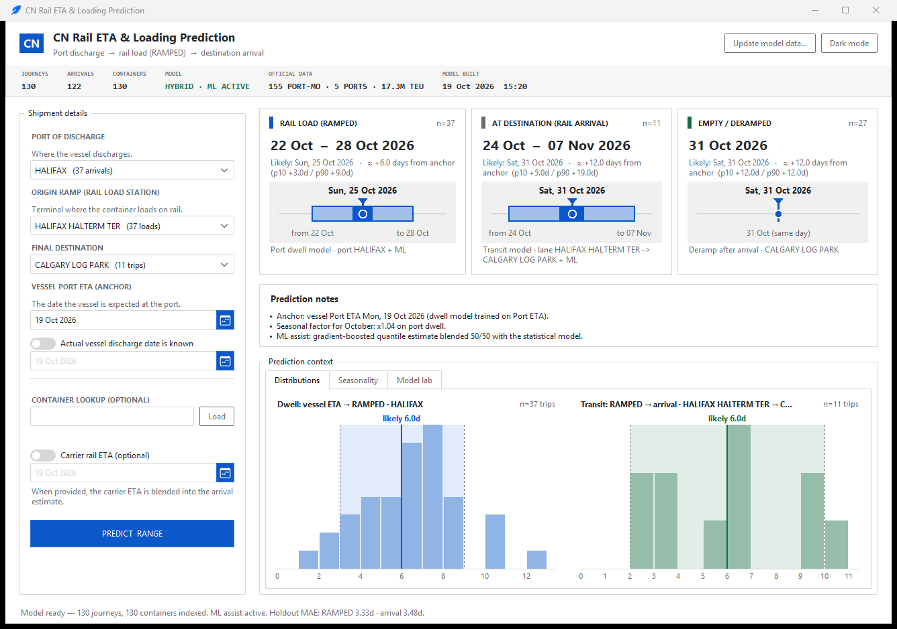
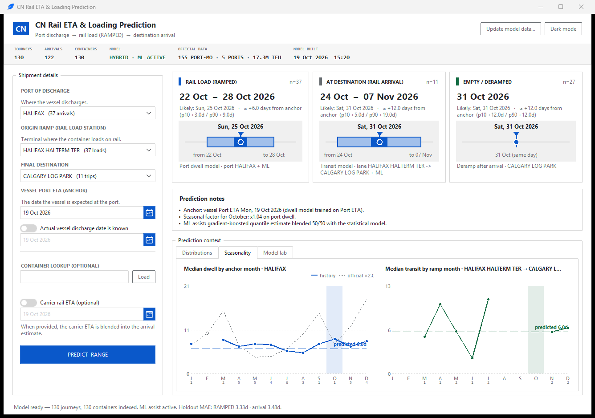
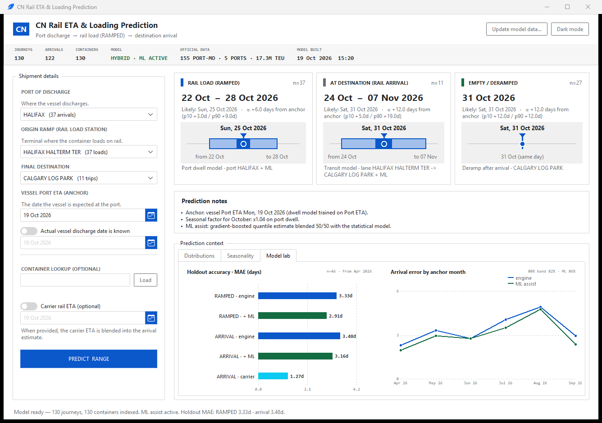

# CN Rail ETA & Loading Prediction

A desktop tool for predicting when a container will be loaded on rail, when it
will arrive at its destination terminal, and when it will be empty/deramped.
Predictions are returned as an 80% range (p10–p90) plus a most-likely date
(p50), and every adjustment is explained in the UI.

The repository is an open-source, MIT-licensed version of the tool. It ships
**no shipment data**; you provide a single-sheet workbook.



*Screenshots use the synthetic demo workbook, so the dates and accuracy numbers
are illustrative.*

## What it does

- Predicts **RAMPED**, **AT DESTINATION** and **DERAMPED** dates from a vessel
  ETA or a confirmed discharge date.
- Uses empirical quantiles by port, lane, month and weekday, with hierarchical
  shrinkage for sparse lanes.
- Aligns estimates when sibling containers on the same vessel have already
  ramped.
- Optionally blends the carrier's own rail ETA.
- Optional gradient-boosted ML assist for the centre of the estimate; the
  calibrated empirical range is kept.
- Overlays official Transport Canada monthly port-dwell seasonality.
- Includes a Model lab tab with rolling holdout diagnostics.
- Dark/light themes, container lookup, update dialog, and a single-sheet data
  format.

## Screenshots

| Seasonality | Model lab |
|---|---|
|  |  |

## Quick start

Requirements: **Python 3.11+** and Tk support (the standard Windows/macOS Python
installers include it).

```bash
python -m venv .venv
# Windows: .\.venv\Scripts\activate
# macOS/Linux: source .venv/bin/activate
python -m pip install -r requirements.txt
```

Create a workbook and run the app:

```bash
# empty template to fill with your shipments
python scripts/make_template.py --out data/CN_Rail_Data.xlsx

# or generate a synthetic workbook to try the UI immediately
python scripts/make_template.py --demo --out data/CN_Rail_Data.xlsx

python app.py
```

The app reads `data/CN_Rail_Data.xlsx` by default. Use **Update model data…** in
the header to validate and load another workbook. Data files are gitignored.

## Data format

One workbook, one sheet (`Shipments`), one row per container. The row contains
shipment details, vessel ETA, discharge date, carrier rail ETA, and actual rail
events:

```text
Container Number | Port of Discharge | Origin Ramp | Final Destination
Vessel ETA | Discharge Date | Rail ETA | RAMPED | AT DESTINATION | DERAMPED | ...
```

- Required: container, port of discharge, origin ramp, final destination, and
  vessel ETA.
- At least one row must have a `RAMPED` timestamp to train the model.
- Dates can be native Excel dates or ISO/timezone-tagged text.
- See [docs/DATA_FORMAT.md](docs/DATA_FORMAT.md) for all columns, aliases and
  validation rules.

No workbook is committed to the repo. Generate a template locally and keep the
real data file out of version control.

## Model in one minute

1. **Dwell:** empirical quantiles of `RAMPED − Vessel ETA` per port, adjusted
   for month/weekday and aligned to already-ramped same-vessel containers.
2. **Transit:** hierarchical quantiles per origin-ramp → destination lane,
   shrunk toward broader groups when the lane is sparse.
3. **Deramp:** arrival-to-deramp quantiles by destination.
4. **Optional inputs:** confirmed discharge date replaces the anchor; a carrier
   rail ETA is blended into the arrival date; an ML model can shift the centre
   while the empirical range is preserved.

Full formulas, validation tables and limitations:
[PREDICTION_METHOD.md](PREDICTION_METHOD.md).

## Project layout

```text
app.py                    desktop UI (tkinter + ttkbootstrap)
cn_model/
  data.py                 single-sheet loader, master table, cache
  engine.py               quantile engine, same-vessel/ML/carrier blends
  ml.py                   optional gradient-boosted quantile assist
  external.py             official port-dwell series
  backtest.py             leave-one-out/CV backtests and UI diagnostics
scripts/make_template.py  empty template or synthetic demo workbook
external/                 official Transport Canada CSV
docs/
  DATA_FORMAT.md          input schema and examples
  screenshots/            README images
data/                     your workbook (gitignored)
```

## Validation

The reference backtest in `PREDICTION_METHOD.md` reports a leave-one-out MAE of
**2.45 d** for RAMPED and **2.87 d** for rail arrival on the development dataset,
with 88%/92% of actuals inside the 80% range. These figures are illustrative:
your data, lanes and sample sizes will produce different results.

## License

MIT. See [LICENSE](LICENSE).
